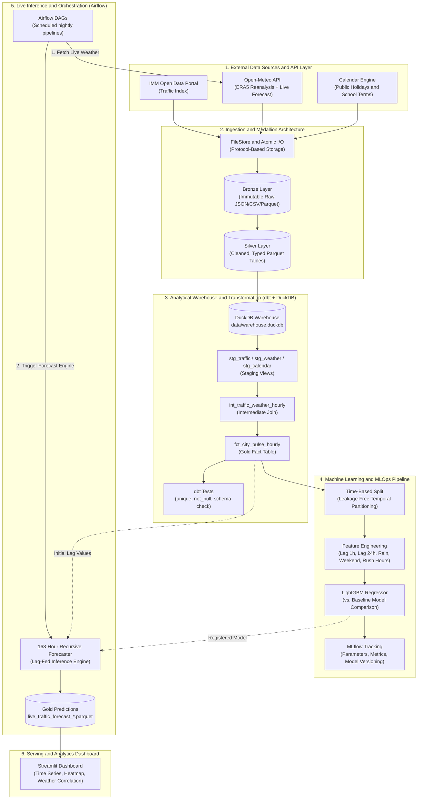

# Istanbul City Pulse — Urban Data Engineering and MLOps Platform

[](https://www.python.org/downloads/)
[](https://github.com/astral-sh/uv)
[](https://www.getdbt.com/)
[](https://duckdb.org/)
[](https://pola.rs/)
[](https://lightgbm.readthedocs.io/)
[](https://mlflow.org/)
[](https://airflow.apache.org/)
[](https://streamlit.io/)
[](https://github.com/astral-sh/ruff)

**Istanbul City Pulse** is an end-to-end Data Engineering and MLOps platform that ingests, models, and analyzes Istanbul's urban dynamics — traffic congestion, meteorological conditions, public holidays, and school academic calendars — in both real-time and historical contexts.

The platform collects raw data from the Istanbul Metropolitan Municipality (IMM) Open Data Portal and Open-Meteo APIs, structures it following the **Medallion Architecture (Bronze → Silver → Gold)** using DuckDB and dbt, and runs an engineered **LightGBM** model with a **Recursive Forecasting** engine to generate automated, continuous **168-hour (7-day)** hourly traffic projections.

---

## End-to-End System Architecture



---

## Technical Stack

| Component | Technology | Rationale |
| :--- | :--- | :--- |
| **Package Manager** | `uv` | 10-100x faster than pip; deterministic lockfile; isolated dependency groups (`dbt`, `ml`, `dev`, `quality`). |
| **Data Processing** | `Polars` | Rust-based multithreaded DataFrame engine on Apache Arrow; eliminates Pandas memory overhead. |
| **Analytical Warehouse** | `DuckDB` | Embedded serverless OLAP engine with zero-copy Parquet reading. |
| **Data Transformation** | `dbt-duckdb` | Modular SQL/Jinja transformations (Staging → Intermediate → Marts) with built-in schema tests. |
| **Machine Learning** | `LightGBM` | High-accuracy gradient-boosted trees optimized for tabular time series. |
| **Forecasting Strategy** | `Recursive Forecasting` | Feeds prior predictions into `lag_1h` / `lag_24h` slots across a 168-hour horizon. |
| **Experiment Tracking** | `MLflow` | Centralized tracking of hyperparameters, metrics (MAE, RMSE, R²), and model versions. |
| **Orchestration** | `Apache Airflow` | Thin DAG design; nightly scheduled pipelines (Istanbul time) with retries and state management. |
| **Dashboard** | `Streamlit + Plotly` | Interactive panel: time series, weekly heatmap, weather impact analysis, CSV export. |
| **Code Quality** | `Ruff + Mypy` | Linting, PEP 8 formatting, and strict static type checking across all source files. |

---

## Directory Layout

```text
Istanbul-City-Pulse/
├── dags/                                 # Apache Airflow DAG definitions
│   ├── weather_live_ingest_dag.py        # 00:00 IST — fetch live weather (Open-Meteo)
│   ├── traffic_live_ingest_dag.py        # Hourly — fetch live IBB traffic index
│   ├── traffic_gold_update_dag.py        # 00:05 IST — merge daily data into Gold table
│   ├── traffic_prediction_dag.py         # 00:15 IST — generate 168-hour forecast
│   └── traffic_model_retrain_dag.py      # Monthly — retrain LightGBM model
├── data/                                 # Local data lake (Git-ignored)
│   ├── bronze/                           # Immutable raw API responses and CSVs
│   ├── silver/                           # Cleaned, standardized hourly Parquet files
│   ├── gold/                             # Analytical fact tables and prediction outputs
│   └── warehouse.duckdb                  # Embedded DuckDB analytical database
├── dbt/                                  # dbt project
│   ├── models/
│   │   ├── staging/                      # Typed views over raw storage (stg_*)
│   │   ├── intermediate/                 # Joined intermediate views
│   │   └── marts/                        # Final fct_city_pulse_hourly fact table
│   ├── profiles.yml                      # DuckDB connection profile
│   └── dbt_project.yml                   # Model configuration
├── docker/                               # Dockerfiles
│   ├── airflow.Dockerfile
│   └── app.Dockerfile
├── docker-compose.yml                    # Postgres + Airflow (init, webserver, scheduler)
├── src/city_pulse/                       # Core Python package
│   ├── domain.py                         # Domain entities, coordinates, constants
│   ├── storage.py                        # Protocol-based atomic file storage
│   ├── config.py                         # Pydantic-settings environment config
│   ├── sql_shell.py                      # Interactive DuckDB SQL shell
│   ├── features/                         # Feature engineering (lags, calendar, weather flags)
│   ├── ingest/                           # API clients (IBB, Open-Meteo)
│   ├── ml/                               # Protocols, baseline, LightGBM, MLflow registry
│   ├── pipelines/                        # ETL, training, and inference pipelines
│   └── dashboard/                        # Streamlit application (app, data, charts)
├── tests/
│   ├── unit/                             # Unit tests with mocked I/O
│   └── integration/                      # End-to-end integration tests
├── Makefile                              # Developer commands
├── pyproject.toml                        # Metadata, tools, dependency groups
└── uv.lock                               # Deterministic lockfile
```

---

## Quickstart

### Prerequisites

| Requirement | Version | Notes |
| :--- | :--- | :--- |
| Python | ≥ 3.12 | [python.org](https://www.python.org/downloads/) |
| uv | latest | `pip install uv` or [docs.astral.sh/uv](https://docs.astral.sh/uv/getting-started/installation/) |
| Docker Desktop | latest | Required only for Airflow orchestration |

---

### 1. Clone and Install

```bash
git clone https://github.com/MuhammedKeremDemirbent/ISTANBUL-CITY-PULSE.git
cd ISTANBUL-CITY-PULSE
make install
```

`make install` runs `uv sync --all-groups` — installs all dependency groups (`ml`, `dbt`, `dev`, `quality`) into an isolated `.venv`.

---

### 2. Run Data Quality Checks (dbt)

Build analytical models from the Gold Parquet file and run schema validation tests:

```bash
make dbt-run    # Builds Staging → Intermediate → Marts in DuckDB
make dbt-test   # Runs unique, not_null, and relationship tests
```

---

### 3. Train the Model

Run the full LightGBM training pipeline. Results are logged to MLflow:

```bash
uv run python -m city_pulse.pipelines.train_model
```

---

### 4. Launch the MLflow UI

Review all training runs, hyperparameters, and metrics:

```bash
make mlflow
```

> Opens at **http://localhost:5000**

---

### 5. Launch the Dashboard

Start the Streamlit dashboard. A live forecast file must exist in `data/gold/predictions/` (generated by the pipeline or manually):

```bash
make dashboard
```

> Opens at **http://localhost:8501**

---

### 6. Start the Airflow Pipeline (Docker)

Airflow automates nightly data ingestion, Gold table updates, and forecast generation.

```bash
# First-time startup (builds Docker images and initializes the Airflow database)
make up

# Check container status
docker compose ps

# View live logs
make logs

# Stop all services
make down
```

> Airflow UI is available at **http://localhost:8080**  
> Default credentials: `admin` / `admin`

#### Nightly Pipeline Schedule (Istanbul Time, UTC+3)

| DAG | Schedule | Action |
| :--- | :--- | :--- |
| `istanbul_weather_live_ingest` | 00:00 | Fetch Open-Meteo weather forecast → Silver |
| `istanbul_traffic_live_ingest` | Every hour `:00` | Fetch IBB traffic index → Silver |
| `istanbul_traffic_gold_update` | 00:05 | Merge daily traffic + weather into Gold table |
| `istanbul_traffic_live_prediction` | 00:15 | Generate 168-hour forecast → `gold/predictions/` |
| `istanbul_traffic_model_retraining` | 2nd of each month | Retrain LightGBM and promote champion model |

---

## Developer Commands

```bash
make check      # Full verification: ruff check, ruff format --check, mypy, pytest
make lint       # Ruff check + Mypy type check
make format     # Ruff format + auto-fix imports
make test       # Run pytest unit tests
make test-cov   # Run tests with coverage report
make shell      # Open interactive DuckDB SQL shell
make clean      # Remove __pycache__, .pytest_cache, .ruff_cache, .mypy_cache
```

---

## Code Quality Standards

All checks run via `make check`:

```bash
uv run ruff check .          # Linting
uv run ruff format --check . # Format verification
uv run mypy src              # Static type checking
uv run pytest                # Unit tests (41 tests, network-isolated)
```

---

## Machine Learning Methodology

- **Time-Based Splitting:** Data partitioned chronologically (Train: 2023–2024, Validation: Jan–Oct 2025, Test: Nov–Dec 2025). Random cross-validation is strictly avoided to prevent lookahead bias.
- **Baseline Benchmark:** LightGBM is benchmarked against a naive Day-of-Week × Hour-of-Day mean baseline. Statistically significant improvements in MAE and RMSE are required before champion promotion.
- **Recursive Lag Updating:** The 168-hour forecast is generated step by step — `lag_1h` and `lag_24h` are initialized from the last known ground-truth value, then dynamically fed from prior predictions at each subsequent step.
- **Champion/Challenger Registry:** MLflow tracks all runs. A new model is promoted to champion only if it outperforms the current registered champion on the held-out test set.

---

## Licenses and Attributions

- **IMM Open Data Portal:** Subject to the terms of the Istanbul Metropolitan Municipality Open Data Portal.
- **Open-Meteo:** ERA5 reanalysis and forecast data are provided under the [Creative Commons Attribution 4.0 International (CC BY 4.0)](https://creativecommons.org/licenses/by/4.0/) license.
- **Project License:** Distributed under the MIT License.
