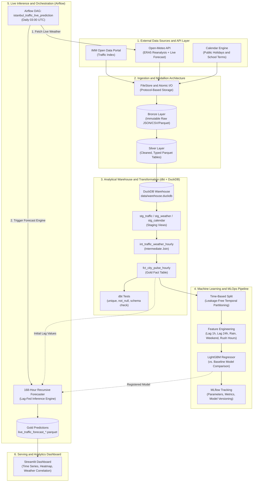

# Istanbul City Pulse — Urban Data Engineering and MLOps Platform

[](https://www.python.org/downloads/)
[](https://github.com/astral-sh/uv)
[](https://www.getdbt.com/)
[](https://duckdb.org/)
[](https://pola.rs/)
[](https://lightgbm.readthedocs.io/)
[](https://mlflow.org/)
[](https://airflow.apache.org/)
[](https://streamlit.io/)
[](https://github.com/astral-sh/ruff)

**Istanbul City Pulse** is an end-to-end Data Engineering and MLOps platform that ingests, models, and analyzes Istanbul's urban dynamics (traffic congestion, meteorological conditions, public holidays, and school academic calendars) in both real-time and historical contexts.

The platform collects raw data from the Istanbul Metropolitan Municipality (IMM) Open Data Portal and Open-Meteo APIs, structures it following the **Medallion Architecture (Bronze -> Silver -> Gold)** using DuckDB and dbt, and runs an engineered **LightGBM** model with a **Recursive Forecasting** engine to generate automated, continuous **168-hour (7-day)** hourly traffic projections.

---

## End-to-End System Architecture

The Mermaid diagram below illustrates the complete data lifecycle from external ingestion to serving:



---

## Core Engineering Principles and Technical Stack

| Component | Technology | Architectural Rationale |
| :--- | :--- | :--- |
| **Package Manager** | `uv` | 10-100x faster execution than pip, deterministic dependency resolution via `uv.lock`, and isolated dependency groups (`dbt`, `ml`, `dev`). |
| **Data Processing** | `Polars` | Rust-based, multithreaded DataFrame engine built on Apache Arrow; eliminates Pandas memory overhead and single-core bottlenecks. |
| **Analytical Warehouse** | `DuckDB` | Embedded, serverless in-process OLAP engine with zero-copy Parquet reading and high-throughput columnar analytics. |
| **Data Transformation & Quality** | `dbt-duckdb` | Modular SQL/Jinja transformations (Staging, Intermediate, Marts) with built-in automated schema and integrity tests (`unique`, `not_null`). |
| **Machine Learning Engine** | `LightGBM` | High-accuracy gradient-boosted decision trees optimized for tabular time series with minimal inference latency. |
| **Forecasting Strategy** | `Recursive Forecasting` | Iteratively feeds preceding predictions into `lag_1h` and `lag_24h` feature slots across a 168-hour forward horizon. |
| **Experiment Tracking** | `MLflow` | Centralized tracking of model hyperparameters, evaluation metrics (MAE, RMSE, R²), and reproducible model versioning. |
| **Workflow Orchestration** | `Apache Airflow` | Thin DAG design pattern executing daily scheduled pipelines (03:00 UTC) with retries, logging, and state management. |
| **Serving & Dashboard** | `Streamlit & Plotly` | Interactive web dashboard featuring date-range sliding windows, weekly congestion heatmaps, and meteorological impact analysis. |
| **Software Architecture** | `SOLID & Protocols` | I/O boundaries decoupled via `typing.Protocol` interfaces (`StorageReader`, `StorageWriter`), atomic writes, strict `Mypy` type checking, and `Ruff` linting. |

---

## Directory Layout

The project adopts a standard `src` layout with strict unidirectional dependencies (`domain <- ingest/storage/features <- ml <- pipelines <- dags/dashboard`):

```text
Istanbul-City-Pulse/
├── dags/                                 # Apache Airflow workflow definitions
│   └── traffic_prediction_dag.py         # Thin DAG triggering daily live inference
├── data/                                 # Local data lake and warehouse (Git-ignored)
│   ├── bronze/                           # Immutable raw API and CSV responses
│   ├── silver/                           # Cleaned, standardized hourly Parquet files
│   ├── gold/                             # Analytical fact tables and prediction outputs
│   └── warehouse.duckdb                  # Embedded DuckDB analytical database
├── dbt/                                  # dbt data warehouse project
│   ├── models/
│   │   ├── staging/                      # Typed views over raw storage (stg_*)
│   │   ├── intermediate/                 # Joined intermediate views
│   │   └── marts/                        # Final fct_city_pulse_hourly fact table
│   ├── profiles.yml                      # Isolated DuckDB connection profile
│   └── dbt_project.yml                   # Model configurations and materializations
├── src/city_pulse/                       # Core Python package
│   ├── domain.py                         # Pure domain entities, coordinates, and constants
│   ├── storage.py                        # Protocol-based atomic file storage (FileStore)
│   ├── config.py                         # Pydantic-settings environment configuration
│   ├── sql_shell.py                      # Interactive DuckDB SQL shell
│   ├── features/                         # Feature engineering (lags, calendar, weather)
│   ├── ingest/                           # External API clients (IMM, Open-Meteo, TomTom)
│   ├── ml/                               # ML protocols, baseline model, LightGBM, and MLflow
│   ├── pipelines/                        # Executable ETL, training, and inference pipelines
│   └── dashboard/                        # Modular Streamlit application (app, data, charts)
├── tests/                                # Isolated Pytest suite
│   ├── unit/                             # Unit tests with mocked I/O boundaries
│   └── integration/                      # End-to-end integration tests
├── Makefile                              # Standardized developer commands
├── pyproject.toml                        # Project metadata, tools, and dependency groups
└── uv.lock                               # Deterministic dependency lockfile
```

---

## Quickstart

### 1. Prerequisites
* **Python:** Version 3.12 or higher.
* **Package Manager:** [uv](https://docs.astral.sh/uv/) installed.

### 2. Environment Setup
Clone the repository and synchronize all dependency groups (`ml`, `dbt`, `dev`, `quality`):

```bash
git clone https://github.com/MuhammedKeremDemirbent/ISTANBUL-CITY-PULSE.git
cd ISTANBUL-CITY-PULSE
make install
```

### 3. Data Transformations and Quality Tests (dbt)
Compile the analytical models and run automated data integrity tests against DuckDB:

```bash
make dbt-run   # Builds all models (Staging -> Intermediate -> Marts)
make dbt-test  # Runs unique and not-null validation tests
```

### 4. Launch the Live Analytics Dashboard (Streamlit)
Start the interactive monitoring panel displaying the 168-hour forecast, heatmaps, and peak-hour analysis:

```bash
make dashboard
```
> The dashboard will automatically open in your browser: `http://localhost:8501`

### 5. Experiment Tracking (MLflow UI)
Review trained model runs, hyperparameters, and evaluation metrics:

```bash
make mlflow
```
> MLflow UI is available at: `http://localhost:5000`

---

## Code Quality and Testing Standards

All code contributions adhere to strict quality gates. Run all verification checks locally:

```bash
make check
```

This target runs the following checks in sequence:
1. `uv run ruff check .` (Python linting)
2. `uv run ruff format --check .` (PEP 8 code formatting verification)
3. `uv run mypy src` (Strict static type verification)
4. `uv run pytest tests` (Network-isolated unit and integration tests)

---

## Machine Learning Evaluation and Methodology

Tabular time series data with strong temporal seasonality requires strict leakage-free evaluation:
* **Time-Based Splitting:** Data is partitioned chronologically (Training: 2023–2024, Validation: 2025). Random cross-validation is strictly avoided to prevent lookahead bias.
* **Baseline Regressor:** LightGBM performance is benchmarked against a naive "Day-of-Week x Hour-of-Day" baseline model, verifying statistically significant reductions in MAE and RMSE.
* **Recursive Lag Updating:** When projecting 168 hours into the future, the model initializes lags with the last known ground-truth traffic value, then dynamically injects its own previous predictions into `lag_1h` and `lag_24h` for subsequent steps.

---

## Licenses and Attributions

* **IMM Open Data Portal:** Subject to the terms and conditions of the Istanbul Metropolitan Municipality Open Data Portal.
* **Open-Meteo:** ERA5 reanalysis and weather forecast data are provided under the [Creative Commons Attribution 4.0 International (CC BY 4.0)](https://creativecommons.org/licenses/by/4.0/) license.
* **Project License:** Distributed under the MIT License.
