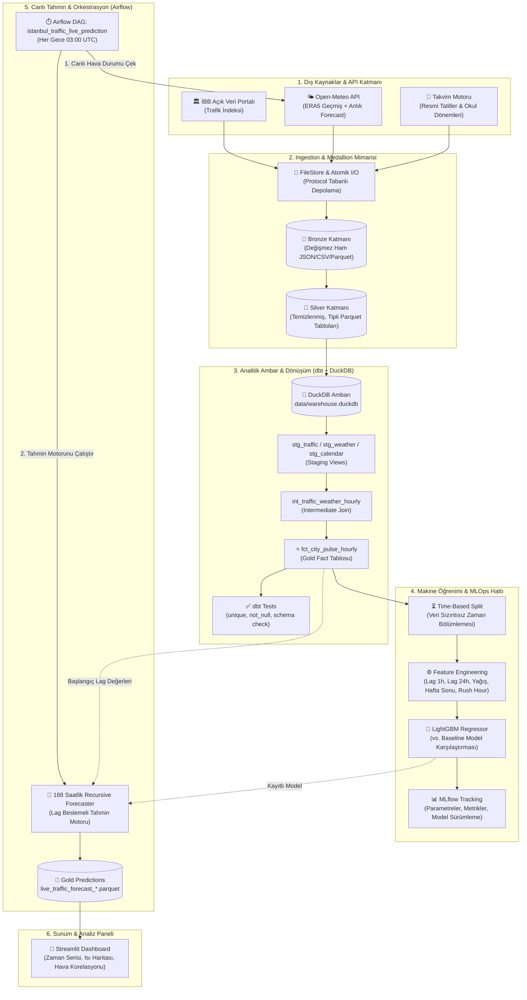

# 🏙️ Istanbul City Pulse — Kentsel Veri Mühendisliği ve MLOps Platformu

[](https://www.python.org/downloads/)
[](https://github.com/astral-sh/uv)
[](https://www.getdbt.com/)
[](https://duckdb.org/)
[](https://pola.rs/)
[](https://lightgbm.readthedocs.io/)
[](https://mlflow.org/)
[](https://airflow.apache.org/)
[](https://streamlit.io/)
[](https://github.com/astral-sh/ruff)

**Istanbul City Pulse**, İstanbul'un kentsel dinamiklerini (trafik yoğunluğu, meteorolojik koşullar, resmi tatil ve okul takvimleri) gerçek zamanlı ve geçmişe dönük olarak işleyen, modernize edilmiş bir **Veri Ambarı (Data Warehouse)** ve **MLOps** platformudur.

Platform, İBB Açık Veri Portalı ve Open-Meteo API'lerinden toplanan verileri **Medallion Mimarisi (Bronze $\rightarrow$ Silver $\rightarrow$ Gold)** prensibiyle DuckDB ve dbt üzerinde işler; eğitilmiş LightGBM modeli ve **Özyinelemeli Tahmin (Recursive Forecasting)** motoruyla önümüzdeki **168 saatin (7 gün)** şehir içi trafik projeksiyonunu otomatik olarak üretir.

---

## 📐 Uçtan Uca Sistem Mimarisi

Aşağıdaki Mermaid akış diyagramı, verinin dış dünyadan toplanmasından başlayarak kullanıcı paneline kadar izlediği yolu gösterir:



---

## 🛠️ Temel Mühendislik Standartları ve Teknolojik Tercihler

| Bileşen | Kullanılan Teknoloji | Neden Tercih Edildi? |
| :--- | :--- | :--- |
| **Paket Yöneticisi** | `uv` | `pip`'e göre 10-100 kat daha hızlı, deterministik kilit dosyası (`uv.lock`) ve izole bağımlılık grupları (`dbt`, `ml`, `dev`). |
| **Veri İşleme** | `Polars` | Pandas'ın bellek tüketiminden ve tek çekirdek kısıtından kaçınmak için; Rust tabanlı, çok çekirdekli (multithreaded) ve Arrow yerel mimarisi. |
| **Analitik Veri Ambarı** | `DuckDB` | Sunucusuz (in-process), yüksek hızlı OLAP sorguları; doğrudan Parquet okuma/yazma desteği. |
| **Veri Dönüşümü & Test** | `dbt-duckdb` | SQL/Jinja ile modüler dönüşüm katmanları (Staging, Intermediate, Marts); boru hattı öncesi otomatik veri kalitesi testleri (`unique`, `not_null`). |
| **Makine Öğrenimi** | `LightGBM` | Tablosal zaman serisi verilerinde derin öğrenme ve doğrusal modellere kıyasla üstün başarım, düşük çıkarım (inference) süresi. |
| **Zaman Serisi Stratejisi** | `Recursive Forecasting` | Geleceğe dönük 168 saat boyunca her saatin tahminini bir sonraki saatin `lag_1h` ve `lag_24h` girdisi olarak dinamik besleme. |
| **Deney Takibi** | `MLflow` | Modellerin, hiperparametrelerin ve metriklerin (MAE, RMSE, R²) sistematik kaydı ve şampiyon model seçimi. |
| **İş Akışı Orkestrasyonu** | `Apache Airflow` | İnce DAG prensibi; canlı hava tahmini çekimi ve çıkarım hattının periyodik (03:00 UTC) güvenilir icrası. |
| **Görselleştirme** | `Streamlit & Plotly` | Airflow çıktısını anlık yansıtan, interaktif zaman serisi slider'ı, haftalık yoğunluk ısı haritası ve meteorolojik korelasyon paneli. |
| **Kod Mimarisi** | `SOLID & Protocols` | I/O sınırlarında soyutlamalar (`StorageReader`, `StorageWriter`), tip güvenliği (`Mypy`), katı lintleme (`Ruff`). |

---

## 📂 Dizin Yapısı

Proje standart `src` layout mimarisine ve katmanlı bağımlılık yönüne (`domain ← ingest/storage ← pipelines ← dags/dashboard`) sahiptir:

```text
Istanbul-City-Pulse/
├── dags/                                 # Apache Airflow DAG tanımları
│   └── traffic_prediction_dag.py         # Canlı tahmin hattını tetikleyen ince DAG
├── data/                                 # Yerel veri ambarı (Git'e eklenmez)
│   ├── bronze/                           # Ham API ve CSV yanıtları
│   ├── silver/                           # Temizlenmiş Parquet tabloları
│   ├── gold/                             # Analitik tablolar ve canlı tahminler
│   └── warehouse.duckdb                  # dbt/DuckDB analitik veritabanı
├── dbt/                                  # dbt Veri Ambarı Projesi
│   ├── models/
│   │   ├── staging/                      # Ham tablolardan tipli view'lar (stg_*)
│   │   ├── intermediate/                 # Trafik, hava ve takvim birleştirme
│   │   └── marts/                        # fct_city_pulse_hourly fact tablosu
│   ├── profiles.yml                      # İzole DuckDB bağlantı profili
│   └── dbt_project.yml                   # Model konfigürasyonları
├── src/city_pulse/                       # Ana Python kaynak kodu
│   ├── domain/                           # Saf veri modelleri ve sabitler (Entities)
│   ├── ingest/                           # Dış API adaptörleri (İBB, Open-Meteo)
│   ├── storage/                          # Protocol tabanlı atomik disk yazıcıları
│   ├── features/                         # Lag, takvim ve hava durumu öznitelik mühendisliği
│   ├── ml/                               # Model eğitimi, TimeSplit, Baseline ve LightGBM
│   ├── pipelines/                        # Orkestrasyon akışları (Inference & Ingestion)
│   └── dashboard/                        # Modüler Streamlit paneli (data, charts, app)
├── tests/                                # Ağ ve diskten bağımsız Pytest testleri
│   ├── unit/                             # Birim testler (Sahte modeller & mocklar)
│   └── integration/                      # Modül entegrasyon testleri
├── Makefile                              # Standartlaştırılmış proje komutları
├── pyproject.toml                        # Proje ayarları ve bağımlılık grupları
└── uv.lock                               # Deterministik bağımlılık kilidi
```

---

## 🚀 Hızlı Başlangıç

### 1. Gereksinimler
* **Python:** 3.12+
* **Paket Yöneticisi:** [uv](https://docs.astral.sh/uv/) kurulu olmalıdır.

### 2. Kurulum
Projeyi klonlayıp tüm bağımlılık gruplarını (`ml`, `dbt`, `dev`) tek seferde senkronize edin:

```bash
git clone https://github.com/KULLANICI_ADIN/Istanbul-City-Pulse.git
cd Istanbul-City-Pulse
make install
```

### 3. Veri Dönüşümü ve Kalite Testleri (dbt)
DuckDB üzerindeki analitik modelleri derleyin ve veri bütünlüğü testlerini çalıştırın:

```bash
make dbt-run   # Modelleri oluşturur (Staging -> Marts)
make dbt-test  # Unique ve Not-Null testlerini koşturur
```

### 4. Canlı Kontrol Panelini Başlatma (Streamlit)
Modelin ürettiği 168 saatlik canlı tahminleri, ısı haritasını ve pik saat analizlerini tarayıcıda açın:

```bash
make dashboard
```
> Panel yerel tarayıcınızda otomatik olarak açılır: `http://localhost:8501`

### 5. Deney Takibi (MLflow UI)
Eğitilen modellerin parametre ve metriklerini incelemek için:

```bash
make mlflow
```
> MLflow arayüzü: `http://localhost:5000`

---

## 🧪 Testler ve Kod Kalitesi

Projede yazılan her kod katı kalite standartlarına tabidir. Teslim öncesi tüm kontrollerin yeşil olması zorunludur:

```bash
make check
```

Bu komut arka planda sırasıyla şunları çalıştırır:
1. `uv run ruff check .` $\rightarrow$ Hızlı Python linter kontrolü.
2. `uv run ruff format --check .` $\rightarrow$ PEP 8 kod stili doğrulaması.
3. `uv run mypy src` $\rightarrow$ Katı statik tip güvenliği denetimi.
4. `uv run pytest` $\rightarrow$ Ağ ve diskten bağımsız birim testleri.

---

## 📊 Makine Öğrenimi Başarım Kriterleri

Trafik yoğunluğu gibi güçlü periyodik (sezonsallık) içeren zaman serilerinde saf rastgele eğitim/test ayrımı **veri sızıntısına (data leakage)** yol açar. Bu nedenle:
* **Time-Based Split:** Veri kronolojik olarak bölünmüştür (Eğitim: 2023–2024, Doğrulama: 2025).
* **Baseline Regressor:** Eğitilen LightGBM modeli, "Haftanın Günü $\times$ Günün Saati" ortalamasını alan basit bir baz model ile kıyaslanmış; belirgin biçimde daha düşük MAE ve RMSE ürettiği doğrulanmıştır.
* **Recursive Lag Güncellemesi:** 168 saatlik geleceğe tahmin yapılırken ilk 24 saat son bilinen gerçek trafikten, sonraki saatler ise modelin bir önceki tahminlerinden (`lag_1h` ve `lag_24h`) dinamik olarak beslenmektedir.

---

## 📜 Lisans ve Atıflar

* **İBB Açık Veri Portalı:** İstanbul Büyükşehir Belediyesi açık veri lisansı koşullarına tabidir.
* **Open-Meteo:** ERA5 yeniden analiz ve hava tahmin verileri [Creative Commons Attribution 4.0 (CC BY 4.0)](https://creativecommons.org/licenses/by/4.0/) lisansıyla kullanılmıştır.
* **Proje Lisansı:** MIT Lisansı ile sunulmaktadır.
